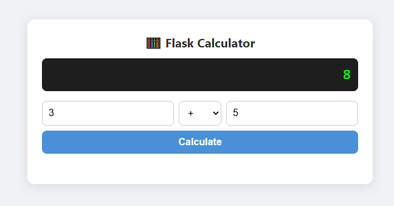

## Full-Stack Flask Calculator with Automated CI/CD 


# 🧮 Flask Calculator App


A full-stack web calculator application built with Python and Flask. This project not only implements basic frontend-backend calculation features but is also equipped with a complete pipeline featuring **automated testing (Pytest)**, **Continuous Integration/Continuous Deployment (GitHub Actions)**, and **containerized deployment (Docker)**. It serves as a standard, industry-level practice project for small-scale applications.

## ✨ Features

- **Basic Operations**: Supports addition (`+`), subtraction (`-`), multiplication (`×`), and division (`÷`).
- **Frontend**: Responsive design built with pure vanilla HTML/CSS/JS, using the `fetch` API for seamless, no-refresh calculations.
- **Robust Error Handling**: Includes division-by-zero interception, invalid input validation, and returns standard JSON error responses.
- **Frontend-Backend Separation**: The frontend sends POST requests in JSON format to the backend API (`/calculate`).

## 🛠️ Tech Stack

- **Backend**: Python 3.9, Flask
- **Frontend**: HTML5, CSS3, Vanilla JavaScript (Fetch API)
- **Testing**: Pytest
- **Deployment & CI/CD**: Docker, Gunicorn, GitHub Actions, Docker Hub

## 📸 Screenshot


## 🚀 How to Use

### Option 1: Run directly with Docker (Recommended)
If you have Docker installed, you can start this application with a single command:

```bash
docker run -p 5000:5000 zoey12321/flasktest-app:latest


## Project structure

learning_git/
├── .github/workflows/    # GitHub Actions CI/CD configuration files
│   └── cicd.yml
├── templates/            # Frontend HTML templates
│   └── index.html
├── app.py                # Flask backend core logic
├── test_app.py           # Pytest unit tests
├── requirements.txt      # Python dependency list
├── Dockerfile            # Docker image build file
├── .dockerignore         # Docker ignore configuration
└── README.md             # Project documentation


## Learning sources

https://www.youtube.com/watch?v=9oALxmc5yEw

https://github.com/krishnaik06/dockerimagehub

--------------------------------------------------------------------------------

# 🧮 Flask Calculator App


一个基于 Python Flask 构建的全栈 Web 计算器应用。本项目不仅实现了基础的前后端交互计算功能，
还配备了完整的**自动化测试 (Pytest)**、**持续集成/持续部署 (GitHub Actions)** 
以及 **容器化部署 (Docker)** 流水线，是一个标准的工业级小型项目实践。

## ✨ 功能特性

- **基础运算**：支持加 (`+`)、减 (`-`)、乘 (`×`)、除 (`÷`) 四则运算。
- **优雅的前端**：响应式设计，纯原生 HTML/CSS/JS 编写，使用 `fetch` API 实现无刷新计算。
- **健壮的错误处理**：包含除数为零拦截、非法输入验证，并返回标准的 JSON 错误提示。
- **前后端分离通信**：前端通过 JSON 格式向后端 API (`/calculate`) 发送 POST 请求。

## 🛠️ 技术栈

- **后端**：Python 3.9, Flask
- **前端**：HTML5, CSS3, Vanilla JavaScript (Fetch API)
- **测试**：Pytest
- **部署与 CI/CD**：Docker, Gunicorn, GitHub Actions, Docker Hub

## 📸 界面预览

<!-- 建议你运行项目后截个图，把图片保存在项目根目录（或者创建一个 images 文件夹），然后把下面的链接替换成你的图片路径 -->


## 🚀 如何使用

### 方式一：直接使用 Docker 运行（推荐）
如果你安装了 Docker，只需一行命令即可启动此应用：

```bash
docker run -p 5000:5000 zoey12321/flasktest-app:latest


## 项目结构

learning_git/
├── .github/workflows/    # GitHub Actions CI/CD 配置文件
│   └── cicd.yml
├── templates/            # 前端 HTML 模板
│   └── index.html
├── app.py                # Flask 后端核心逻辑
├── test_app.py           # Pytest 单元测试代码
├── requirements.txt      # Python 依赖包清单
├── Dockerfile            # Docker 镜像构建文件
├── .dockerignore         # Docker 忽略文件配置
└── README.md             # 项目说明文档

## 学习资源

https://www.youtube.com/watch?v=9oALxmc5yEw
https://github.com/krishnaik06/dockerimagehub
