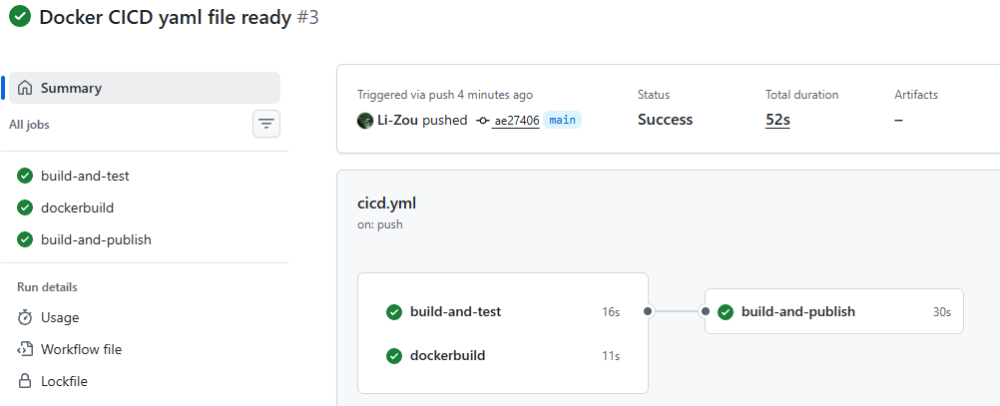
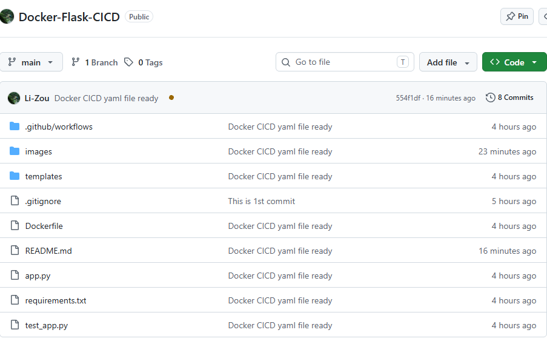

## Full-Stack Flask Calculator with Automated CI/CD 

---
# 🚀🚀🚀🚀  Part 1  🚀🚀🚀🚀
---
# 🧮 Flask Calculator App


A full-stack web calculator application built with Python and Flask. This project not only implements basic frontend-backend calculation features but is also equipped with a complete pipeline featuring **automated testing (Pytest)**, **Continuous Integration/Continuous Deployment (GitHub Actions)**, and **containerized deployment (Docker)**. It serves as a standard, industry-level practice project for small-scale applications.

## ✨ Features

- **Basic Operations**: Supports addition (`+`), subtraction (`-`), multiplication (`×`), and division (`÷`).
- **Frontend**: Responsive design built with pure vanilla HTML/CSS/JS, using the `fetch` API for seamless, no-refresh calculations.
- **Robust Error Handling**: Includes division-by-zero interception, invalid input validation, and returns standard JSON error responses.
- **Frontend-Backend Separation**: The frontend sends POST requests in JSON format to the backend API (`/calculate`).

## 🛠️ Tech Stack

- **Backend**: Python 3.9, Flask
- **Frontend**: HTML5, CSS3, Vanilla JavaScript (Fetch API)
- **Testing**: Pytest
- **Deployment & CI/CD**: Docker, Gunicorn, GitHub Actions, Docker Hub

## 📸 Screenshot




## 🚀 How to Use

### Option 1: Run directly with Docker (Recommended)
If you have Docker installed, you can start this application with a single command (in bash):

```text
docker run -p 5000:5000 zoey12321/flasktest-app:latest
```


## Project structure

```text
learning_git/
├── .github/workflows/    # GitHub Actions CI/CD configuration files
│   └── cicd.yml
├── templates/            # Frontend HTML templates
│   └── index.html
├── app.py                # Flask backend core logic
├── test_app.py           # Pytest unit tests
├── requirements.txt      # Python dependency list
├── Dockerfile            # Docker image build file
├── .dockerignore         # Docker ignore configuration
└── README.md             # Project documentation
```


## Learning sources

https://www.youtube.com/watch?v=9oALxmc5yEw

https://github.com/krishnaik06/dockerimagehub


---
# 🚀🚀🚀🚀  Part 2  🚀🚀🚀🚀
---
# 🚀 Full Workflow: Local Development → Git → Docker

This guide covers the complete lifecycle of the project: from running it locally, pushing to GitHub, and finally running it anywhere using Docker.

## Step 1: Prepare Files Locally
Set up the standard project structure with all necessary files (Flask app, tests, requirements, Dockerfile, etc.) as outlined in the Project Structure section.



## Step 2: Run & Test Locally
Open a terminal in the project directory and execute the following commands to set up the environment, install dependencies, and start the app:

```powershell
# Check Python version
py --version

# Create and activate virtual environment
py -m venv venv
Set-ExecutionPolicy -ExecutionPolicy RemoteSigned -Scope CurrentUser
.\venv\Scripts\Activate.ps1

# Install dependencies
pip install -r requirements.txt

# Run the Flask app
python app.py

```
## Step 3: Initialize Git & Push to GitHub
Initialize a local Git repository and push the code to your GitHub remote repository

```bash
git init
git add .
git commit -m 'This is 1st commit'
git branch -M main
git remote add origin https://github.com/Li-Zou/Docker-Flask-CICD.git
git push -u origin main

```

## Step 4: Push Subsequent Updates
Every time you make local modifications (e.g., adding the CI/CD YAML file), push the changes to GitHub:

```bash
git add .
git commit -m 'Docker CICD yaml file ready'
git push -u origin main

```

## Step 5: Run Anywhere via Docker Hub
Once the deployment pipeline is complete and the image is pushed to Docker Hub, any computer with Docker installed can run this app:

```bash
docker run -p 5000:5000 zoey12321/flasktest-app:latest

```
👉 Access the app: Open your browser and go to http://localhost:5000


---
# 🚀🚀🚀🚀  Part 3  🚀🚀🚀🚀
---

# 🧮 Flask Calculator App


一个基于 Python Flask 构建的全栈 Web 计算器应用。本项目不仅实现了基础的前后端交互计算功能，
还配备了完整的**自动化测试 (Pytest)**、**持续集成/持续部署 (GitHub Actions)** 
以及 **容器化部署 (Docker)** 流水线，是一个标准的工业级小型项目实践。

## ✨ 功能特性

- **基础运算**：支持加 (`+`)、减 (`-`)、乘 (`×`)、除 (`÷`) 四则运算。
- **优雅的前端**：响应式设计，纯原生 HTML/CSS/JS 编写，使用 `fetch` API 实现无刷新计算。
- **健壮的错误处理**：包含除数为零拦截、非法输入验证，并返回标准的 JSON 错误提示。
- **前后端分离通信**：前端通过 JSON 格式向后端 API (`/calculate`) 发送 POST 请求。

## 🛠️ 技术栈

- **后端**：Python 3.9, Flask
- **前端**：HTML5, CSS3, Vanilla JavaScript (Fetch API)
- **测试**：Pytest
- **部署与 CI/CD**：Docker, Gunicorn, GitHub Actions, Docker Hub

## 📸 界面预览

<!-- 建议你运行项目后截个图，把图片保存在项目根目录（或者创建一个 images 文件夹），然后把下面的链接替换成你的图片路径 -->


## 🚀 如何使用

### 方式一：直接使用 Docker 运行（推荐）
如果你安装了 Docker，只需一行命令即可启动此应用 (in bash)：

```text
docker run -p 5000:5000 zoey12321/flasktest-app:latest
```

## 项目结构

```text
learning_git/
├── .github/workflows/    # GitHub Actions CI/CD configuration files
│   └── cicd.yml
├── templates/            # Frontend HTML templates
│   └── index.html
├── app.py                # Flask backend core logic
├── test_app.py           # Pytest unit tests
├── requirements.txt      # Python dependency list
├── Dockerfile            # Docker image build file
├── .dockerignore         # Docker ignore configuration
└── README.md             # Project documentation
```

## 学习资源

https://www.youtube.com/watch?v=9oALxmc5yEw

https://github.com/krishnaik06/dockerimagehub
